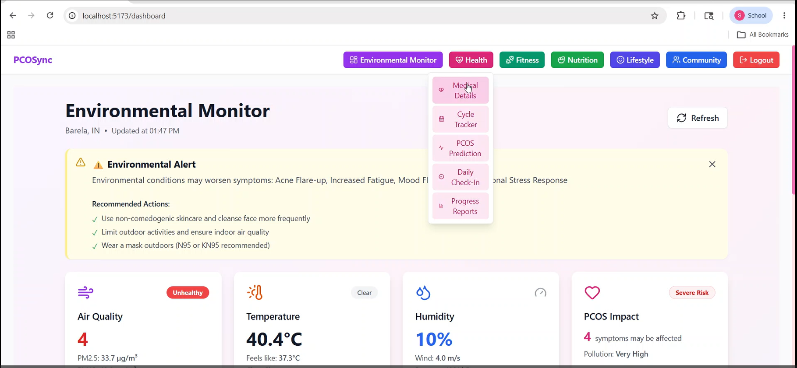

<div align="center">
  
</div>

⚙️ Backend – install these

cd backend

npm install express mongoose dotenv cors axios jsonwebtoken bcryptjs node-cron

npm install --save-dev nodemon

⚠️ When working with the virtual try-on feature there is an optional mock mode that simply returns the uploaded user photo instead of calling the model. You can toggle mock responses by setting the environment variable `USE_MOCK_VTON=true` for development/testing.

### CP‑VTon model setup

The backend now uses the open‑source CP‑VTon project for try-on instead of a paid API. A copy of the repository is checked out to `backend/tryon-model`.

- **Python dependencies & environment:**

  ```bash
  cd backend/tryon-model
  python -m venv venv
  source venv/bin/activate    # Windows: `venv\\Scripts\\activate`
  # install packages; the original repo provides environment.yml:
  pip install -r requirements.txt       # or `conda env create -f environment.yml`
  ```

  Make sure `python` (the interpreter from the venv) is on your `PATH`.

- **Pretrained weights:** download a compatible CP‑VTon checkpoint and
  place it at `tryon-model/checkpoint.pth` (or update the path in
  `run.py`).

- **run.py behavior:** the Node backend invokes the script with three
  arguments:

  ```text
  python run.py <person_image> <clothes_image> <output_image>
  ```

  Internally the service will try to locate a Python interpreter for you:
  it first checks the **CP_VTON_PYTHON** environment variable, then
  looks for `backend/tryon-model/venv` (Songs of Windows vs Unix paths are
  handled automatically).  If neither is found it falls back to the plain
  `python` command.

  > If you encounter `spawn python ENOENT`, either install Python on your
  > PATH or set `CP_VTON_PYTHON` to the absolute path of the desired
  > executable (e.g. the one inside your virtualenv).

  The provided `run.py` contains a comprehensive template showing how to
  load the PyTorch network, preprocess inputs, run inference and save
  the result.  During early development the script simply copies the
  person image; uncomment or replace the appropriate sections once your
  model and checkpoint are ready.

  Alternatively you can call `test.py` directly from `run.py` as shown
  in the comments.

  Whichever method you choose, ensure the script exits with code `0` and
  writes the output image; the backend will then respond with
  `{ success: true, resultImageUrl: "/outputs/…" }`.

Once the environment is configured, POSTing images to `/api/virtual-tryon` will run the model locally and return a URL such as `/outputs/result-123456.png`.

> The old AiPhotocraft API keys (`AIPHOTOCRAFT_API_URL`, `AIPHOTOVR_KEY`, etc.) are no longer used and can be removed from `.env` if present.

The `backend/src/config/apikeys.js` file has been removed since it is no longer needed. 

⚙️ Frontend – install these

cd frontend

npm install react react-dom react-router-dom

npm install axios

npm install lucide-react

npm install sonner

npm install next-themes

npm install @radix-ui/react-slot

npm install class-variance-authority

npm install clsx

npm install tailwind-merge

⚙️ Tailwind CSS Setup

npm install -D tailwindcss postcss autoprefixer

npx tailwindcss init -p

⚙️ Vite React Plugin

npm install -D @vitejs/plugin-react


